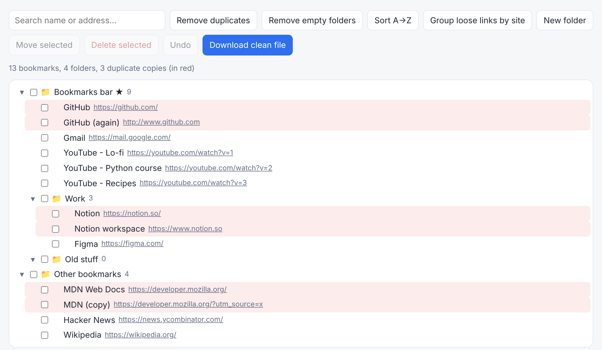

# AI Bookmark Organizer (Lesezeichen-Organizer)

[English](README.md) · [Português](README.pt-BR.md) · [Español](README.es.md) · [Français](README.fr.md) · **Deutsch** · [Italiano](README.it.md) · [Русский](README.ru.md) · [简体中文](README.zh-CN.md) · [日本語](README.ja.md) · [한국어](README.ko.md) · [हिन्दी](README.hi.md) · [العربية](README.ar.md)

Räumen Sie die Lesezeichen Ihres Browsers auf, selbst oder indem Sie eine KI darum bitten.



Das Projekt besteht aus drei Teilen:

- **[Web-Tool](https://dpfcarlos.github.io/ai-bookmark-organizer/)**: eine Seite, die in Ihrem Browser läuft. Exportierte Lesezeichen laden, Duplikate und leere Ordner entfernen, Links nach Website gruppieren, sortieren, verschieben, umbenennen, löschen und eine saubere Datei herunterladen. Nichts wird hochgeladen.
- **MCP-Server**: lässt die KI die Lesezeichen von Chrome, Edge, Brave, Vivaldi, Opera und Chromium direkt auf Ihrem Computer lesen und ändern: auflisten, suchen, Duplikate und tote Links finden, in Ordner umsortieren, exportieren, alles löschen und einen neuen Satz laden, Sicherungen wiederherstellen.
- **Skill** (`organize-bookmarks`): bringt der KI das sichere Vorgehen bei: zuerst sichern, prüfen, ob der Browser geschlossen ist, Vorschau zeigen und erst nach Ihrer Bestätigung anwenden.

## 1. Web-Tool (ohne Installation)

Öffnen Sie **https://dpfcarlos.github.io/ai-bookmark-organizer/** (oder laden Sie [`docs/index.html`](docs/index.html) herunter und öffnen Sie die Datei).

1. **Exportieren** Sie Ihre Lesezeichen: In Chrome, Edge oder Brave `Strg+Umschalt+O` drücken, das Menü ⋮ öffnen und *Lesezeichen exportieren* wählen. In Firefox: `Strg+Umschalt+O` → *Importieren und Sichern* → *Lesezeichen nach HTML exportieren*.
2. **Organisieren** Sie die Datei auf der Seite. Mehrere Dateien können gleichzeitig geladen werden und werden zusammengeführt.
3. **Laden Sie die saubere Datei**: alte Lesezeichen im Browser löschen (`Strg+A`, dann `Entf` in der Lesezeichenverwaltung) und *Lesezeichen importieren* mit der heruntergeladenen Datei verwenden.

Bewahren Sie den ursprünglichen Export auf: Er ist Ihre Sicherung.

## 2. Die KI erledigen lassen (MCP-Server + Skill)

Voraussetzung: [Node.js](https://nodejs.org) 18 oder neuer. Der Server läuft **auf Ihrem Computer**, weil dort Ihre Lesezeichen liegen; er funktioniert daher mit Desktop-Apps (Claude Desktop, Claude Code, Cursor, VS Code…), nicht mit einem reinen Cloud-Chat.

### Claude Code (Plugin: MCP-Server und Skill in einem Schritt)

```
/plugin marketplace add dpfcarlos/ai-bookmark-organizer
/plugin install ai-bookmark-organizer@ai-bookmark-organizer
```

Nur der MCP-Server:

```bash
claude mcp add ai-bookmark-organizer -- npx -y github:dpfcarlos/ai-bookmark-organizer
```

### Claude Desktop

Öffnen Sie *Settings → Developer → Edit Config* und ergänzen Sie in `claude_desktop_config.json`:

```json
{
  "mcpServers": {
    "ai-bookmark-organizer": {
      "command": "npx",
      "args": ["-y", "github:dpfcarlos/ai-bookmark-organizer"]
    }
  }
}
```

Starten Sie Claude Desktop neu. Für die Skill laden Sie den Ordner [`skills/organize-bookmarks`](skills/organize-bookmarks) als .zip herunter und laden ihn unter *Settings → Capabilities → Skills* hoch.

### Cursor, VS Code, Windsurf und andere MCP-Clients

Verwenden Sie denselben Befehl in den MCP-Einstellungen: `npx -y github:dpfcarlos/ai-bookmark-organizer` (stdio).

### Beispielanfragen

- „Sortiere meine Chrome-Lesezeichen in Ordner nach Thema.“
- „Entferne doppelte Lesezeichen und leere Ordner in Edge.“
- „Finde Lesezeichen mit toten Links.“
- „Exportiere meine Lesezeichen, lösche alle und lade diese saubere Datei: C:\Users\ich\Downloads\bookmarks-organized.html“
- „Mach die letzte Änderung rückgängig.“

## Sicherheit

- **Standardmäßig Probelauf.** Werkzeuge, die etwas ändern, zeigen nur an, was passieren würde, bis sie mit `dry_run: false` aufgerufen werden.
- **Automatische Sicherung** vor jeder Änderung in `~/.bookmark-organizer/backups`. `restore_backup` macht jede Änderung rückgängig.
- **Kein Schreiben bei geöffnetem Browser**, da der Browser die Datei beim Schließen überschreiben würde.
- **Synchronisierung:** Ist sie aktiv, kann der Server gelöschte Einträge zurückbringen. Für große Aufräumaktionen besser *exportieren → organisieren → im Browser alles löschen → saubere Datei importieren*.
- Firefox und Safari werden nicht direkt bearbeitet: nutzen Sie deren HTML-Export mit dem Web-Tool oder `import_html`.

Die vollständige Liste der MCP-Werkzeuge steht im [englischen README](README.md#mcp-tools).

---

MIT-Lizenz. Beiträge sind willkommen.
