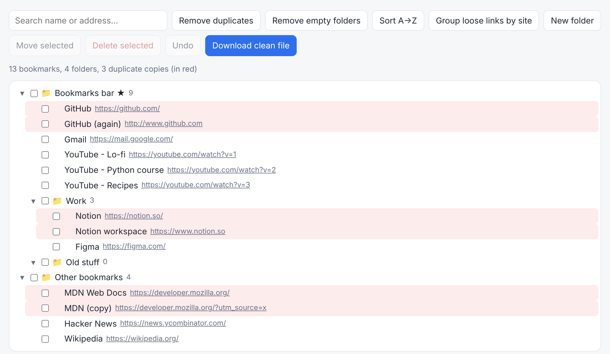

# AI Bookmark Organizer (Organizador de Marcadores)

[English](README.md) · [Português](README.pt-BR.md) · **Español** · [Français](README.fr.md) · [Deutsch](README.de.md) · [Italiano](README.it.md) · [Русский](README.ru.md) · [简体中文](README.zh-CN.md) · [日本語](README.ja.md) · [한국어](README.ko.md) · [हिन्दी](README.hi.md) · [العربية](README.ar.md)

Limpia y organiza los marcadores de tu navegador, a mano o pidiéndole a una IA que lo haga por ti.



El proyecto tiene tres partes:

- **[Herramienta web](https://dpfcarlos.github.io/ai-bookmark-organizer/)**: una página que funciona en tu navegador. Cargas los marcadores exportados, eliminas duplicados y carpetas vacías, agrupas enlaces por sitio, ordenas, mueves, renombras y borras, y descargas un archivo limpio. No se envía nada a internet.
- **Servidor MCP**: permite que la IA lea y modifique los marcadores de Chrome, Edge, Brave, Vivaldi, Opera y Chromium directamente en tu ordenador: listar, buscar, encontrar duplicados y enlaces rotos, reorganizar en carpetas, exportar, borrar todo y cargar un conjunto nuevo, y restaurar copias de seguridad.
- **Skill** (`organize-bookmarks`): enseña a la IA a hacerlo de forma segura: primero una copia de seguridad, comprobar que el navegador está cerrado, mostrar una vista previa y aplicar solo después de tu confirmación.

## 1. Herramienta web (sin instalar nada)

Abre **https://dpfcarlos.github.io/ai-bookmark-organizer/** (o descarga [`docs/index.html`](docs/index.html) y ábrelo).

1. **Exporta** tus marcadores: en Chrome, Edge o Brave pulsa `Ctrl+Shift+O`, abre el menú ⋮ y elige *Exportar marcadores*. En Firefox: `Ctrl+Shift+O` → *Importar y respaldar* → *Exportar marcadores a HTML*.
2. **Organiza** el archivo en la página. Puedes cargar varios archivos a la vez y se combinan.
3. **Carga el archivo limpio**: borra los marcadores antiguos en el navegador (`Ctrl+A` y `Supr` en el administrador de marcadores) y usa *Importar marcadores* con el archivo descargado.

Guarda la exportación original: es tu copia de seguridad.

## 2. Deja que la IA lo haga (servidor MCP + skill)

Requisito: [Node.js](https://nodejs.org) 18 o superior. El servidor se ejecuta **en tu ordenador**, porque ahí están tus marcadores, así que funciona con aplicaciones de escritorio (Claude Desktop, Claude Code, Cursor, VS Code…), no con un chat que se ejecuta solo en la nube.

### Claude Code (plugin con servidor MCP y skill en un paso)

```
/plugin marketplace add dpfcarlos/ai-bookmark-organizer
/plugin install ai-bookmark-organizer@ai-bookmark-organizer
```

Solo el servidor MCP:

```bash
claude mcp add ai-bookmark-organizer -- npx -y github:dpfcarlos/ai-bookmark-organizer
```

### Claude Desktop

Abre *Settings → Developer → Edit Config* y añade a `claude_desktop_config.json`:

```json
{
  "mcpServers": {
    "ai-bookmark-organizer": {
      "command": "npx",
      "args": ["-y", "github:dpfcarlos/ai-bookmark-organizer"]
    }
  }
}
```

Reinicia Claude Desktop. Para añadir la skill, descarga la carpeta [`skills/organize-bookmarks`](skills/organize-bookmarks) como .zip y súbela en *Settings → Capabilities → Skills*.

### Cursor, VS Code, Windsurf y otros clientes MCP

Usa el mismo comando en la configuración MCP del programa: `npx -y github:dpfcarlos/ai-bookmark-organizer` (stdio).

### Ejemplos de peticiones

- "Organiza los marcadores de mi Chrome en carpetas por tema."
- "Elimina los marcadores duplicados y las carpetas vacías de Edge."
- "Encuentra los marcadores con enlaces rotos."
- "Exporta mis marcadores, bórralos todos y carga este archivo limpio: C:\Users\yo\Downloads\bookmarks-organized.html"
- "Deshaz el último cambio."

## Seguridad

- **Simulación por defecto.** Las herramientas que cambian algo solo muestran lo que harían hasta que se llaman con `dry_run: false`.
- **Copia de seguridad automática** antes de cada cambio, en `~/.bookmark-organizer/backups`. `restore_backup` deshace cualquier cambio.
- **No escribe con el navegador abierto**, porque el navegador sobrescribiría el archivo al cerrarse.
- **Sincronización:** si está activada, el servidor puede devolver elementos borrados. Para una limpieza grande, mejor *exportar → organizar → borrar todo en el navegador → importar el archivo limpio*.
- Firefox y Safari no se editan directamente: usa su exportación HTML con la herramienta web o con `import_html`.

La lista completa de herramientas MCP está en el [README en inglés](README.md#mcp-tools).

---

Licencia MIT. Las contribuciones son bienvenidas.
