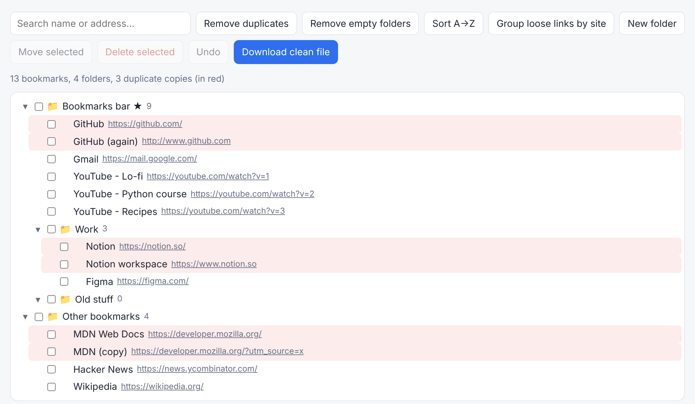

# AI Bookmark Organizer（ブックマーク整理ツール）

[English](README.md) · [Português](README.pt-BR.md) · [Español](README.es.md) · [Français](README.fr.md) · [Deutsch](README.de.md) · [Italiano](README.it.md) · [Русский](README.ru.md) · [简体中文](README.zh-CN.md) · **日本語** · [한국어](README.ko.md) · [हिन्दी](README.hi.md) · [العربية](README.ar.md)

ブラウザのブックマークを、手作業でも AI に任せても整理できます。



このプロジェクトは 3 つの部分でできています。

- **[Web ツール](https://dpfcarlos.github.io/ai-bookmark-organizer/)**：ブラウザ内で動く 1 枚のページです。エクスポートしたブックマークを読み込み、重複や空フォルダの削除、サイト別のまとめ、並べ替え、移動、名前変更、削除を行い、整理済みのファイルをダウンロードできます。データは一切送信されません。
- **MCP サーバー**：AI があなたのパソコン上で Chrome、Edge、Brave、Vivaldi、Opera、Chromium のブックマークを直接読み書きできるようにします。一覧表示、検索、重複やリンク切れの検出、フォルダへの整理、エクスポート、全削除と新しいセットの読み込み、バックアップの復元に対応しています。
- **Skill**（`organize-bookmarks`）：AI に安全な手順を教えます。まずバックアップを取り、ブラウザが閉じていることを確認し、プレビューを見せ、あなたが確認してから実行します。

## 1. Web ツール（インストール不要）

**https://dpfcarlos.github.io/ai-bookmark-organizer/** を開きます（または [`docs/index.html`](docs/index.html) をダウンロードして開きます）。

1. ブックマークを**エクスポート**します。Chrome / Edge / Brave では `Ctrl+Shift+O` を押し、⋮ メニューから*ブックマークをエクスポート*を選びます。Firefox では `Ctrl+Shift+O` → *インポートとバックアップ* → *HTML としてエクスポート*。
2. ページ上でファイルを**整理**します。複数のファイルを一度に読み込むと統合されます。
3. **整理したファイルを読み込みます**。ブラウザの古いブックマークを削除し（ブックマーク マネージャで `Ctrl+A` → `Delete`）、*ブックマークをインポート*でダウンロードしたファイルを選びます。

元のエクスポート ファイルは保管しておいてください。それがバックアップです。

## 2. AI に任せる（MCP サーバー + skill）

[Node.js](https://nodejs.org) 18 以上が必要です。ブックマークはあなたのパソコンにあるため、サーバーも**あなたのパソコンで**動きます。デスクトップ アプリ（Claude Desktop、Claude Code、Cursor、VS Code など）で使えますが、クラウドだけで動くチャットでは使えません。

### Claude Code（プラグイン：MCP サーバーと skill を一度に）

```
/plugin marketplace add dpfcarlos/ai-bookmark-organizer
/plugin install ai-bookmark-organizer@ai-bookmark-organizer
```

MCP サーバーのみ：

```bash
claude mcp add ai-bookmark-organizer -- npx -y github:dpfcarlos/ai-bookmark-organizer
```

### Claude Desktop

*Settings → Developer → Edit Config* を開き、`claude_desktop_config.json` に次を追加します：

```json
{
  "mcpServers": {
    "ai-bookmark-organizer": {
      "command": "npx",
      "args": ["-y", "github:dpfcarlos/ai-bookmark-organizer"]
    }
  }
}
```

Claude Desktop を再起動します。skill を追加するには、[`skills/organize-bookmarks`](skills/organize-bookmarks) フォルダを .zip でダウンロードし、*Settings → Capabilities → Skills* でアップロードします。

### Cursor、VS Code、Windsurf などの MCP クライアント

各ソフトの MCP 設定で同じコマンドを使います：`npx -y github:dpfcarlos/ai-bookmark-organizer`（stdio）。

### 依頼の例

- 「Chrome のブックマークをテーマ別のフォルダに整理して」
- 「Edge の重複ブックマークと空のフォルダを削除して」
- 「リンク切れのブックマークを探して」
- 「ブックマークをエクスポートして全部削除し、この整理済みファイルを読み込んで：C:\Users\me\Downloads\bookmarks-organized.html」
- 「最後の変更を元に戻して」

## 安全性

- **既定ではドライラン。** 変更を伴うツールは、`dry_run: false` で呼ばれるまで何が起きるかを表示するだけです。
- 変更のたびに `~/.bookmark-organizer/backups` へ**自動バックアップ**します。`restore_backup` でどの変更も元に戻せます。
- **ブラウザが開いている間は書き込みません。** 閉じるときにブラウザがファイルを上書きしてしまうためです。
- **同期：** 有効な場合、削除した項目が同期サーバーから戻ることがあります。大掃除には *エクスポート → 整理 → ブラウザで全削除 → 整理済みファイルをインポート* の流れがおすすめです。
- Firefox と Safari は直接編集しません。HTML エクスポートを Web ツールまたは `import_html` で使ってください。

MCP ツールの一覧は[英語の README](README.md#mcp-tools) にあります。

---

MIT ライセンス。コントリビューション歓迎です。
