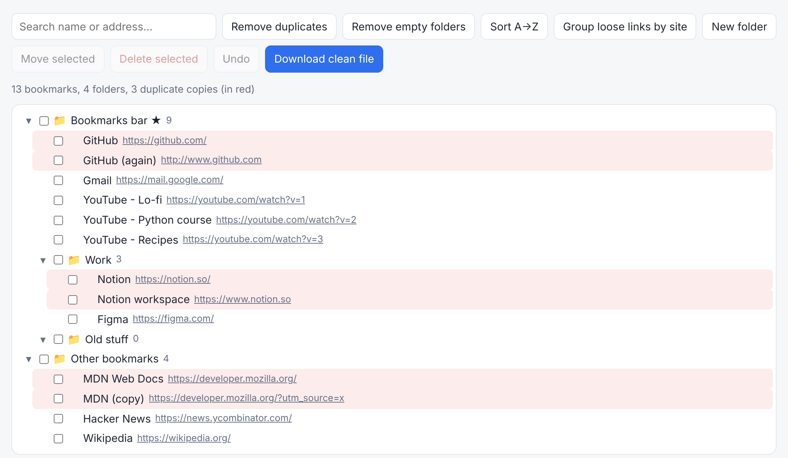

# AI Bookmark Organizer (Органайзер закладок)

[English](README.md) · [Português](README.pt-BR.md) · [Español](README.es.md) · [Français](README.fr.md) · [Deutsch](README.de.md) · [Italiano](README.it.md) · **Русский** · [简体中文](README.zh-CN.md) · [日本語](README.ja.md) · [한국어](README.ko.md) · [हिन्दी](README.hi.md) · [العربية](README.ar.md)

Очищайте и упорядочивайте закладки браузера вручную или поручите это ИИ.



Проект состоит из трёх частей:

- **[Веб-инструмент](https://dpfcarlos.github.io/ai-bookmark-organizer/)**: страница, которая работает прямо в браузере. Загрузите экспортированные закладки, удалите дубликаты и пустые папки, сгруппируйте ссылки по сайтам, отсортируйте, переместите, переименуйте, удалите лишнее и скачайте чистый файл. Ничего никуда не отправляется.
- **MCP-сервер**: позволяет ИИ читать и изменять закладки Chrome, Edge, Brave, Vivaldi, Opera и Chromium прямо на вашем компьютере: показывать, искать, находить дубликаты и битые ссылки, раскладывать по папкам, экспортировать, удалять всё и загружать новый набор, восстанавливать резервные копии.
- **Skill** (`organize-bookmarks`): учит ИИ действовать безопасно: сначала резервная копия, проверка, что браузер закрыт, предпросмотр и применение только после вашего подтверждения.

## 1. Веб-инструмент (без установки)

Откройте **https://dpfcarlos.github.io/ai-bookmark-organizer/** (или скачайте [`docs/index.html`](docs/index.html) и откройте его).

1. **Экспортируйте** закладки: в Chrome, Edge или Brave нажмите `Ctrl+Shift+O`, откройте меню ⋮ и выберите *Экспортировать закладки*. В Firefox: `Ctrl+Shift+O` → *Импорт и резервные копии* → *Экспорт закладок в HTML-файл*.
2. **Упорядочьте** файл на странице. Можно загрузить несколько файлов сразу — они объединятся.
3. **Загрузите чистый файл**: удалите старые закладки в браузере (`Ctrl+A`, затем `Delete` в диспетчере закладок) и выберите *Импортировать закладки* со скачанным файлом.

Сохраните исходный экспорт — это ваша резервная копия.

## 2. Пусть это сделает ИИ (MCP-сервер + skill)

Требуется [Node.js](https://nodejs.org) 18 или новее. Сервер работает **на вашем компьютере**, где хранятся закладки, поэтому он подходит для настольных приложений (Claude Desktop, Claude Code, Cursor, VS Code…), а не для чата, работающего только в облаке.

### Claude Code (плагин: MCP-сервер и skill за один шаг)

```
/plugin marketplace add dpfcarlos/ai-bookmark-organizer
/plugin install ai-bookmark-organizer@ai-bookmark-organizer
```

Только MCP-сервер:

```bash
claude mcp add ai-bookmark-organizer -- npx -y github:dpfcarlos/ai-bookmark-organizer
```

### Claude Desktop

Откройте *Settings → Developer → Edit Config* и добавьте в `claude_desktop_config.json`:

```json
{
  "mcpServers": {
    "ai-bookmark-organizer": {
      "command": "npx",
      "args": ["-y", "github:dpfcarlos/ai-bookmark-organizer"]
    }
  }
}
```

Перезапустите Claude Desktop. Чтобы добавить skill, скачайте папку [`skills/organize-bookmarks`](skills/organize-bookmarks) в виде .zip и загрузите её в *Settings → Capabilities → Skills*.

### Cursor, VS Code, Windsurf и другие MCP-клиенты

Используйте ту же команду в настройках MCP программы: `npx -y github:dpfcarlos/ai-bookmark-organizer` (stdio).

### Примеры запросов

- «Разложи закладки моего Chrome по папкам по темам».
- «Удали дубликаты закладок и пустые папки в Edge».
- «Найди закладки с битыми ссылками».
- «Экспортируй мои закладки, удали их все и загрузи этот чистый файл: C:\Users\я\Downloads\bookmarks-organized.html».
- «Отмени последнее изменение».

## Безопасность

- **Пробный запуск по умолчанию.** Инструменты, которые что-то меняют, только показывают результат, пока их не вызовут с `dry_run: false`.
- **Автоматическая резервная копия** перед каждым изменением в `~/.bookmark-organizer/backups`. `restore_backup` отменяет любое изменение.
- **Не записывает при открытом браузере**, иначе браузер перезапишет файл при закрытии.
- **Синхронизация:** если она включена, сервер может вернуть удалённое. Для большой чистки лучше *экспорт → упорядочить → удалить всё в браузере → импортировать чистый файл*.
- Firefox и Safari напрямую не изменяются: используйте их HTML-экспорт с веб-инструментом или `import_html`.

Полный список MCP-инструментов — в [README на английском](README.md#mcp-tools).

---

Лицензия MIT. Вклад приветствуется.
