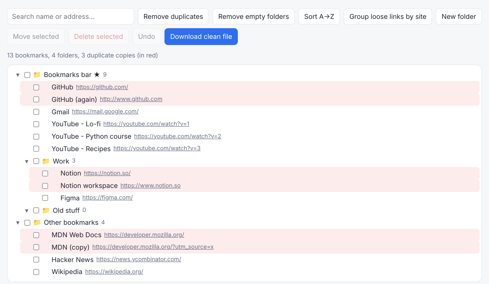

# AI Bookmark Organizer（书签整理器）

[English](README.md) · [Português](README.pt-BR.md) · [Español](README.es.md) · [Français](README.fr.md) · [Deutsch](README.de.md) · [Italiano](README.it.md) · [Русский](README.ru.md) · **简体中文** · [日本語](README.ja.md) · [한국어](README.ko.md) · [हिन्दी](README.hi.md) · [العربية](README.ar.md)

整理浏览器书签：可以自己动手，也可以让 AI 帮你完成。



项目包含三部分：

- **[网页工具](https://dpfcarlos.github.io/ai-bookmark-organizer/)**：在浏览器中运行的单个页面。载入导出的书签，删除重复项和空文件夹，按网站归类链接，排序、移动、重命名、删除，然后下载整理好的文件。不会上传任何数据。
- **MCP 服务器**：让 AI 直接在你的电脑上读取和修改 Chrome、Edge、Brave、Vivaldi、Opera 和 Chromium 的书签：列出、搜索、查找重复和失效链接、按文件夹重新整理、导出、全部删除并载入新书签、恢复备份。
- **Skill**（`organize-bookmarks`）：教 AI 安全地操作：先备份，确认浏览器已关闭，展示预览，只有在你确认后才执行。

## 1. 网页工具（无需安装）

打开 **https://dpfcarlos.github.io/ai-bookmark-organizer/**（或下载 [`docs/index.html`](docs/index.html) 后直接打开）。

1. **导出**书签：在 Chrome、Edge 或 Brave 中按 `Ctrl+Shift+O`，打开 ⋮ 菜单并选择*导出书签*。Firefox：`Ctrl+Shift+O` → *导入和备份* → *导出书签到 HTML*。
2. 在页面中**整理**文件。可以一次载入多个文件，它们会被合并。
3. **载入整理好的文件**：在浏览器中删除旧书签（在书签管理器中按 `Ctrl+A` 再按 `Delete`），然后用*导入书签*选择下载的文件。

请保留原始导出文件，它就是你的备份。

## 2. 让 AI 来做（MCP 服务器 + skill）

需要 [Node.js](https://nodejs.org) 18 或更高版本。服务器运行在**你的电脑上**，因为书签就在那里；所以它适用于桌面应用（Claude Desktop、Claude Code、Cursor、VS Code 等），不适用于只在云端运行的聊天。

### Claude Code（插件：一步安装 MCP 服务器和 skill）

```
/plugin marketplace add dpfcarlos/ai-bookmark-organizer
/plugin install ai-bookmark-organizer@ai-bookmark-organizer
```

仅安装 MCP 服务器：

```bash
claude mcp add ai-bookmark-organizer -- npx -y github:dpfcarlos/ai-bookmark-organizer
```

### Claude Desktop

打开 *Settings → Developer → Edit Config*，在 `claude_desktop_config.json` 中加入：

```json
{
  "mcpServers": {
    "ai-bookmark-organizer": {
      "command": "npx",
      "args": ["-y", "github:dpfcarlos/ai-bookmark-organizer"]
    }
  }
}
```

重启 Claude Desktop。若要添加 skill，将 [`skills/organize-bookmarks`](skills/organize-bookmarks) 文件夹下载为 .zip，并在 *Settings → Capabilities → Skills* 中上传。

### Cursor、VS Code、Windsurf 及其他 MCP 客户端

在程序的 MCP 设置中使用同一命令：`npx -y github:dpfcarlos/ai-bookmark-organizer`（stdio）。

### 示例请求

- “把我 Chrome 里的书签按主题整理到文件夹中。”
- “删除 Edge 中重复的书签和空文件夹。”
- “找出链接失效的书签。”
- “导出我的书签，全部删除，然后载入这个整理好的文件：C:\Users\me\Downloads\bookmarks-organized.html”
- “撤销上一次修改。”

## 安全

- **默认为预演模式。** 会修改内容的工具在使用 `dry_run: false` 调用之前，只显示将会发生的变化。
- 每次修改前都会**自动备份**到 `~/.bookmark-organizer/backups`。`restore_backup` 可以撤销任何修改。
- **浏览器打开时不会写入**，否则浏览器关闭时会覆盖文件。
- **同步：** 如果开启了书签同步，服务器可能会恢复已删除的项目。大规模整理时，建议采用*导出 → 整理 → 在浏览器中全部删除 → 导入整理好的文件*的流程。
- Firefox 和 Safari 不会被直接修改：请使用它们的 HTML 导出文件，配合网页工具或 `import_html`。

MCP 工具的完整列表见[英文 README](README.md#mcp-tools)。

---

MIT 许可证。欢迎贡献。
